<picture>
  <source media="(prefers-color-scheme: dark)" srcset="./assets/dark.svg">
  <source media="(prefers-color-scheme: light)" srcset="./assets/light.svg">
  
</picture>

I work where **numerical correctness** meets **systems engineering** — Bayesian diagnostics where a wrong `rhat` silently corrupts someone's research, and agent pipelines where an unsupervised write is a security incident.

[Portfolio](https://personal-portfolio-compiq.vercel.app) &nbsp;·&nbsp;
[LinkedIn](https://linkedin.com/in/mohd-ayaan-7731b4381) &nbsp;·&nbsp;
[LeetCode](https://leetcode.com/u/sheikhayaan/) &nbsp;·&nbsp;
[sheikhayaan408@gmail.com](mailto:sheikhayaan408@gmail.com)

<picture>
  <source media="(prefers-color-scheme: dark)" srcset="./assets/signals-dark.svg">
  <source media="(prefers-color-scheme: light)" srcset="./assets/signals-light.svg">
  
</picture>

The donut counts merged PRs by upstream project. The bars measure language bytes across every public repo — markup and tooling included, so they show repository bulk rather than effort.

<picture>
  <source media="(prefers-color-scheme: dark)" srcset="./assets/pipeline-dark.svg">
  <source media="(prefers-color-scheme: light)" srcset="./assets/pipeline-light.svg">
  
</picture>

How a change moves through <a href="https://github.com/sheikhayaan/AUTOPR">AutoPR</a>: the router can auto-post a low-risk comment, but the only path to a real write is a human approving the queued decision.

---

## Open source

Six merged pull requests in the scientific Python stack — the work I'm proudest of, because these are libraries other people's research depends on.

| PR | What it does | Repo |
| :-- | :-- | :-- |
| [#485](https://github.com/arviz-devs/arviz-stats/pull/485) | Added an `axis` argument and DataArray interface to the `r2` functions | `arviz-stats` |
| [#474](https://github.com/arviz-devs/arviz-stats/pull/474) | Fixed superchain counts in `rhat_nested` using `np.unique` | `arviz-stats` |
| [#399](https://github.com/arviz-devs/arviz-stats/pull/399) | Fixed the `reloo` k-threshold | `arviz-stats` |
| [#392](https://github.com/arviz-devs/arviz-stats/pull/392) | Added a helpful error when `hdi_prob` is passed instead of `prob` | `arviz-stats` |
| [#2601](https://github.com/arviz-devs/arviz/pull/2601) | Documented the `hdi_prob` → `prob` migration path | `arviz` |
| [#4270](https://github.com/zarr-developers/zarr-python/pull/4270) | Skipped exact byte comparison for the gzip codec (timestamp variance) | `zarr-python` |

## Selected work

**[AutoPR](https://github.com/sheikhayaan/AUTOPR)** — Multi-agent PR reviewer that repairs failing CI, gated behind human approval.
A LangGraph pipeline reviews diffs, drafts tests, and proposes fixes. Anything that mutates code, or carries non-trivial risk, is queued for a human rather than applied.
`Python` `FastAPI` `LangGraph` `Redis Streams` `Postgres` `Docker`

**[DocMind AI](https://github.com/sheikhayaan/DOCMIND-AI)** — RAG chatbot: upload a PDF, get answers grounded in that document, with citations.
`Next.js` `TypeScript` `FastAPI` `LangChain` `Pinecone` &nbsp;·&nbsp; [live demo](https://docmind-ai-dusky.vercel.app)

**[CompIQ](https://github.com/sheikhayaan/compiq)** — Compensation intelligence that compares offers by *level*, not job title. Google L5 = Meta E5 = Amazon L6.
`Next.js` `TypeScript` `Prisma` `Tailwind` &nbsp;·&nbsp; [live demo](https://compiq-three.vercel.app)

**[Hybrid Data Pipeline](https://github.com/sheikhayaan/Hybrid-Data-Pipeline)** — A C++ data engine generates synthetic housing records over a CSV boundary into a Pandas + scikit-learn training workflow. Seeded and re-runnable.
`C++` `Python` `scikit-learn` `Docker`

**[PrepAI](https://github.com/sheikhayaan/PrepAi)** — Full-stack AI mock-interview platform with async job processing behind a Redis + BullMQ queue.
`React` `Node` `Express` `MongoDB`

**[Suhana AI](https://github.com/sheikhayaan/Suhana-Ai)** — Flask-based AI creator studio: script generation, reel rendering, PDF and image tooling, credit tracking, BYOK API keys.
`Flask` `Docker` `ffmpeg`

## Experience

**SDE Intern** · ITJOBXS — Jobs & Education Platform · *Jun 2026 – Jul 2026*
Built full-stack web applications and an AI microservice pipeline. Delivered a MERN e-commerce product for a client end to end; shipped interview-experience and user-verification flows; hardened registration with Google reCAPTCHA.

**Cybersecurity Virtual Intern** · C-DAC Noida (Govt. of India) · *Jul 2025 – Aug 2025*
Audited network topologies, tested system access controls, and ran vulnerability scans against server infrastructure, under the Cyber Gyan Project.

## Toolbox

| | |
| :-- | :-- |
| **Languages** | Python · TypeScript · JavaScript · C++ · SQL |
| **Backend** | FastAPI · Flask · Express · SQLAlchemy · Alembic · Redis · Postgres · MongoDB |
| **AI / Data** | LangChain · LangGraph · RAG · vector databases · Pandas · scikit-learn · NumPy |
| **Frontend** | React · Next.js · Tailwind CSS |
| **Infra** | Docker · GitHub Actions · Fly.io · Render · Vercel |
| **Foundations** | Probability & Statistics · Numerical Methods · Data Structures & Algorithms |

## How I build

1. **Safety before autonomy.** An agent that can write code should propose, not commit.
2. **Numerical code is guilty until proven correct.** Edge cases in statistics libraries don't throw — they quietly return the wrong number.
3. **Write the error message you wish you'd received.** Several of my merged PRs are exactly this.
4. **Reproducibility is a feature.** Seed the RNG, pin the deps, make the pipeline re-runnable.

---

B.Tech Mathematics & Computing · Delhi Technological University · 2024–2028 
Open to SDE and backend / infrastructure internship opportunities.
